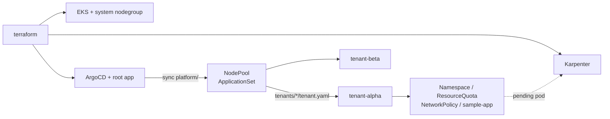

# eks-tenant-gitops

EKS 위에서 테넌트(namespace) 하나를 Git 커밋 하나로 온보딩하는 구성.
Terraform은 클러스터와 ArgoCD까지만 만들고, 그 뒤는 전부 ArgoCD가 이 리포를 보고 맞춘다.
업무에서 다뤘던 멀티테넌트 온보딩 패턴을 개인적으로 다시 짜본 것.



## 테넌트 추가

1. `tenants/<이름>/tenant.yaml` 생성 (quota 등 바꿀 값만, 기본값은 `charts/tenant/values.yaml`)
2. main에 push
3. ArgoCD가 `tenant-<이름>` Application 생성 → 리소스 배포. 디렉터리 지우면 같이 정리됨

## 실행

```bash
cd terraform
terraform init && terraform apply
$(terraform output -raw configure_kubectl)
```

비용 나옴 (EKS, NAT GW, 노드). 다 봤으면 `terraform destroy`.
destroy 전에 karpenter가 띄운 노드가 남아있으면 VPC 삭제가 막히니 `kubectl get nodeclaims` 비었는지 확인.
